  
 
  
 
     
 
  

$ cat about.txt
text
> full-stack engineer from Ukraine. 6+ years, web + mobile + AI.
> I own features end-to-end: Next.js / React Native on the front,
> Node.js / Python on the back, Docker + AWS underneath.
> currently: open to remote B2B roles (EU/US overlap).
$ ls ./stack

      

AI / LLM: OpenAI · Claude API · LangChain · RAG · Pinecone · Qdrant Mobile: React Native · Expo · Expo Router · EAS Build / OTA

$ git log --oneline --author="Stanislav"
diff
+ 9e1c4a7  feat: NutriPulse onboarding 54% → 71%, crash-free 99.6%
+ 4b7d2f0  perf: AI meal-plan generation ~8s → ~3s (caching + fallback)
+ c83a91e  ci: EAS Build + OTA, releases 2 weeks → 3–4 days
+ 1f5e6b2  refactor: Django REST → FastAPI, p95 800ms → <100ms
+ 7a0d3c9  feat: RAG on Pinecone/Qdrant, −70% manual doc processing
+ e2b8f14  ci: GitHub Actions → AWS, 10+ deploys/week at 99.7% uptime
+ 5c9a07d  test: coverage 45% → 85% (Jest, Playwright, PyTest)
+ d41e8b3  perf: Lighthouse ~50 → 85+, LCP ~4s → ~2s, −35% JS bundle
+ 0a6f2e1  feat: realtime chat for 1,000+ concurrent users, <100ms delivery
+ 3b1c5d8  chore: mentored 7 engineers, 2 promoted to mid/senior
$ cat experience.log
<table> <tr><th>when</th><th>where</th><th>what</th></tr> <tr><td>2023 – 2026</td><td><b>STX Next</b> · Senior Full-Stack</td><td>AI products for legal-tech &amp; health-tech: DocuMind AI, NutriPulse</td></tr> <tr><td>2021 – 2023</td><td><b>Scopic</b> · Middle Full-Stack</td><td>B2B SaaS &amp; EdTech: TryTami, MyEdSpace</td></tr> <tr><td>2020</td><td><b>GeekyAnts</b> · Junior Full-Stack</td><td>React Native real-estate app Torii, MVP launch</td></tr> </table>

<code>// if it's slow, I'll find out why. if it's broken, it was probably a cache.</code>

